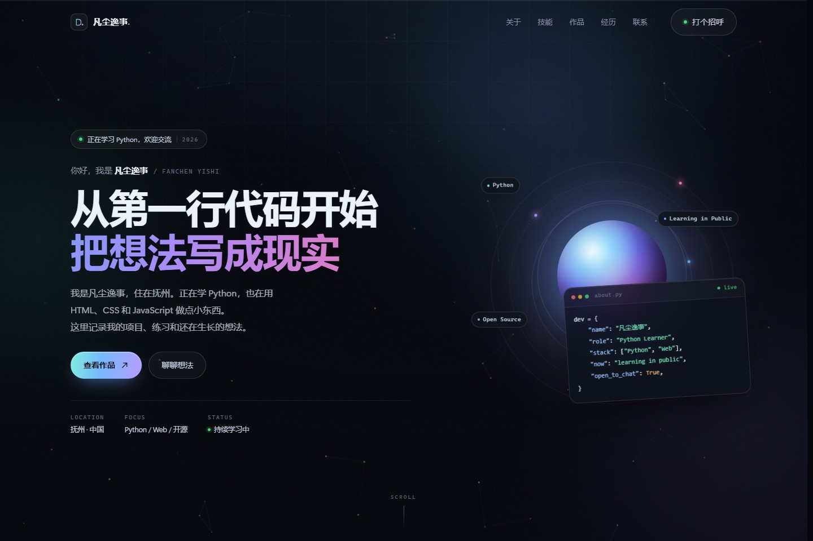

# 凡尘逸事 · 个人主页

> 从第一行代码开始，把想法写成现实。

一个无框架、无后端、无外部依赖的纯静态个人主页。深色极光视觉、Canvas 粒子背景，内容全部由 `js/data.js` 驱动。

**在线预览：<https://cmsj33071.win/>**



## 特点

- **零依赖**：原生 HTML / CSS / JavaScript，无构建步骤、无第三方运行时
- **视觉**：极光渐变、Canvas 粒子连线、噪点纹理、玻璃拟态与轨道球首屏
- **交互**：滚动揭示、数字计数、时间线进度、导航高亮、阅读进度、3D 倾斜
- **作品**：DSH Session Manager、App Packer、Myhome 三个真实项目，支持详情弹窗与分类筛选
- **响应式**：390 / 768 / 1440 / 1920 四档验证，移动端无横向滚动
- **可访问**：键盘可达、焦点陷阱、`prefers-reduced-motion` 降级、语义化标题层级

## 快速开始

```bash
git clone https://github.com/cmsj33071/myhome.git
cd myhome
python -m http.server 4173
# 打开 http://127.0.0.1:4173
```

也可以直接双击 `index.html` 打开。

## 修改内容

所有文案、项目、技能、时间线与联系方式都在 `js/data.js`，改完刷新即可：

| 字段 | 内容 |
| --- | --- |
| `profile` | 姓名、邮箱、城市、首屏文案、社交链接 |
| `stats` | 首页数字看板 |
| `about` | 个人简介与亮点 |
| `skills` | 技能分组、自评进度、技术标签 |
| `projects` | 项目名称、描述、技术栈、仓库链接 |
| `timeline` | 经历时间线 |
| `contact` | 联系区文案 |

> `projects[].featured` 控制卡片是否使用大尺寸布局；`projects[].link` 存在时，详情弹窗会出现「查看仓库」。

## 目录结构

```text
.
├── index.html          # 页面结构
├── css/style.css       # 视觉系统与响应式
├── js/data.js          # 唯一内容源
├── js/main.js          # 渲染与交互
├── preview.jpg         # README 预览图
├── robots.txt
├── sitemap.xml
└── CNAME               # 自定义域名
```

## 部署

当前通过 GitHub Pages 从 `main` 分支根目录发布，自定义域名为 `www.cmsj33071.win`。

如果要换成自己的域名：

1. 在仓库 Settings → Pages 填写 Custom domain；
2. 在 DNS 服务商添加 `www` 的 CNAME 指向 `<username>.github.io`，裸域添加 GitHub Pages 的 A 记录；
3. 等证书签发后勾选 **Enforce HTTPS**。

## License

[MIT](LICENSE) © 2026 凡尘逸事
